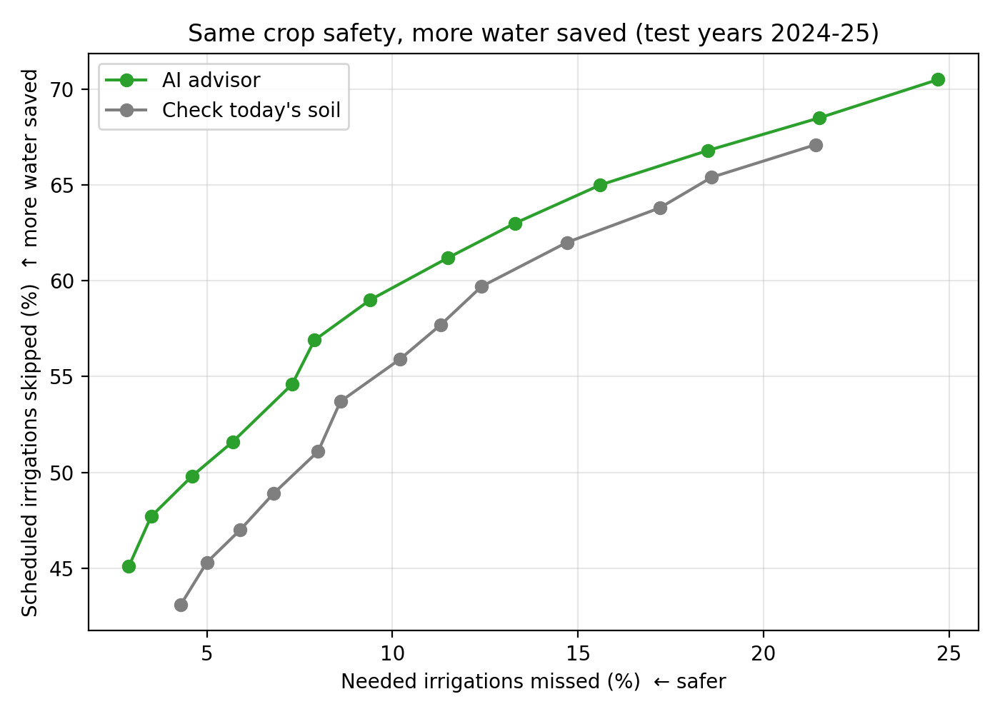
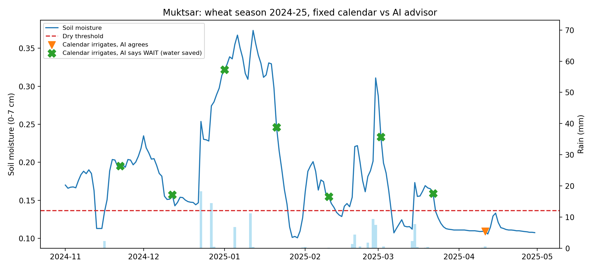
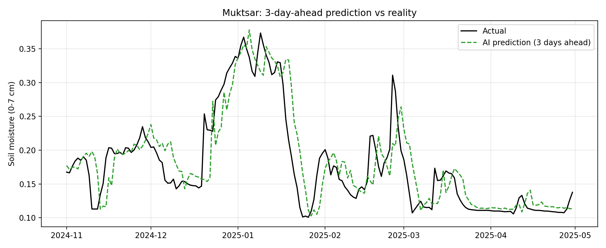
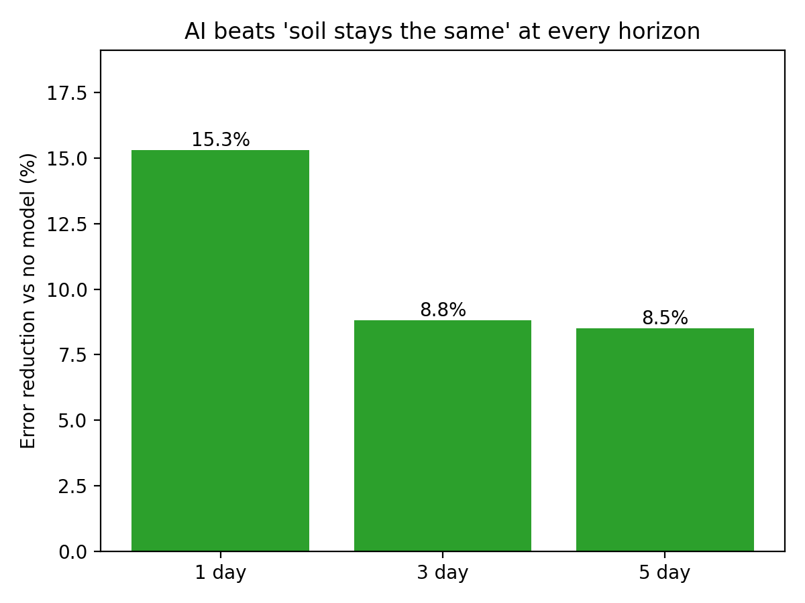
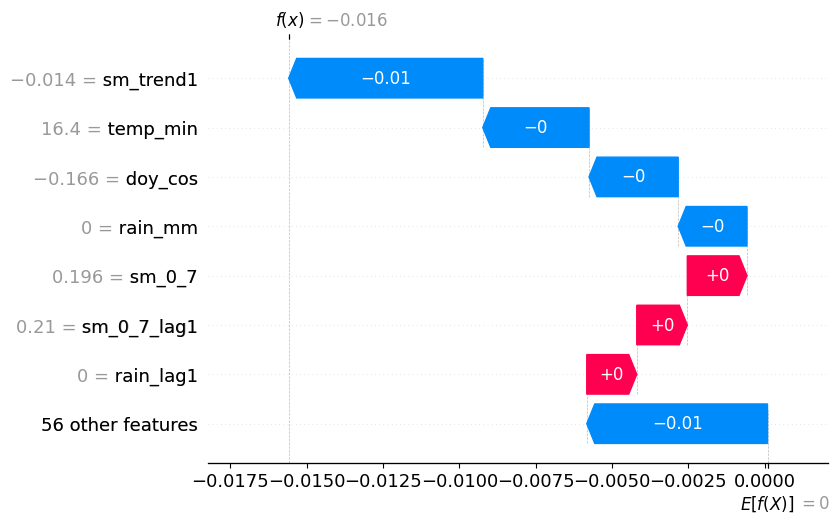

# 💧 Punjab Irrigation Advisor
 
**AI advice for wheat farmers: irrigate today, or wait?**
It predicts soil moisture 3 days ahead and gives a clear WAIT or IRRIGATE answer, with the reason shown.
 
🔗 **Live app:** https://irrigation-advisor-punjab.streamlit.app
 
---
 
## Why this matters
 
Punjab feeds the country, and it is draining the ground beneath it.
 
- Groundwater extraction is at **156%** of what recharges each year.
- **111 of 153** assessment units are over-exploited.
- About **95%** of the water pumped goes to irrigation, through roughly **1.45 million tubewells**.
*Source: CGWB 2025.*
 
Many farms still irrigate on a fixed calendar, whether the soil needs water or not. Every irrigation that can safely be skipped is groundwater left in the aquifer, plus pumping energy and money saved. Farmers need a simple answer they can trust, not another dashboard.
 
## What it does
 
Pick a district and a date. The advisor reads recent soil moisture, rain, temperature and season, predicts soil moisture **3 days ahead**, and compares it with that district's dry-soil limit.
 
- **WAIT:** soil will stay wet enough, no irrigation needed.
- **IRRIGATE:** soil will get too dry within 3 days.
You choose the safety level, from *Save more water* to *Maximum safety*, so the advice matches how much risk you are willing to take.
 
## Results
 
Tested on **unseen years (2024-25)**, wheat season, all 23 districts. The model was trained on data up to 2022, and safety levels were chosen on 2023. Each number pools 9 scenarios: 3 definitions of "too dry" (15th, 25th, 35th percentile) × 3 calendar intervals (every 15, 20 or 25 days).
 

 
**At every safety level, the AI advisor skips more irrigations than simply checking today's soil.** The gap grows as you ask for more safety:
 
| Needed irrigations missed | AI advisor skips | Check today's soil skips |
|---|---|---|
| ~11% | **61.2%** | 57.7% |
| ~8% | **56.9%** | 51.1% |
 
At the default *Balanced* level, the advisor skips **65% of scheduled irrigations** while missing 15.6% of the ones crops needed (the simple rule, tuned the same way: 63.8% skipped, 17.2% missed).
 
### One season, one district
 

 
Muktsar, wheat 2024-25 (the district where the advisor saved the most). A calendar irrigating every 20 days would irrigate 8 times. The advisor agreed with 1 and said **WAIT on 7**, days when the soil was wet and predicted to stay above the dry limit (green ✖).
 
### It sees dry spells coming
 

 
The 3-day-ahead prediction (green) tracks what actually happened (black) through wet spells, rain pulses and the dry end of the season.
 

 
Across test years 2023-25, against the "soil stays the same" baseline, prediction error drops by **15.3%** (1 day), **8.8%** (3 days) and **8.5%** (5 days).
 
## Why it gave this answer
 
Every answer in the app comes with a chart that shows the reasons behind it.
 

 
**How to read it:**
- The chart explains one prediction: the **change in soil moisture over the next 3 days**. It starts at the typical change (bottom, `E[f(X)]`) and ends at this day's predicted change (top, `f(x)`).
- Each bar is one thing the model looked at. **Red pushes moisture up** (favours WAIT). **Blue pushes it down** (favours IRRIGATE). Longer bar means bigger influence.
- The number beside each name is today's value for that factor.
- In this example, soil moisture was already falling (`sm_trend1`), which pulled the prediction down the most.
## Using the app
 
1. **Advisor:** choose district, date and safety level. Read the WAIT/IRRIGATE banner, the three moisture numbers (today, in 3 days, dry limit), and the "Why this answer?" chart.
2. **Results:** the plots above, with plain-language takeaways.
3. **About:** the problem, how it works, and what's next.
The demo replays 2023-25 data, so dates in that range are available.
 
**Run locally:**
```bash
git clone https://github.com/Shaurya-git-bit/irrigation-advisor.git
cd irrigation-advisor
pip install -r requirements.txt
streamlit run irrigation_advisor_app.py
```
 
## How it was built
 
- **Data:** daily weather and soil moisture (0-7 cm) per district from Open-Meteo (ERA5-Land), 2015-2025.
- **Crop calendar:** wheat sown 1 Nov; the calendar irrigates from day 21, every 20 days in the app and plot (15 and 25 days also tested).
- **Dry limit:** set per district from the 25th percentile of historical wheat-season soil moisture (the level the app uses).
- **Model:** XGBoost with 63 features built only from past data (soil moisture at several depths and its trends, rain, evaporation, temperature, days since sowing, time of year), tuned with Optuna on the 1-day task.
- **Safety levels:** a margin added to the dry limit, so the advisor irrigates earlier when you want more safety.
- **Explanations:** SHAP.
## Repository structure
 
```
irrigation-advisor/
├── irrigation_advisor_app.py   # Streamlit app: Advisor, Results and About pages
├── requirements.txt            # Python dependencies for the app
├── README.md                   # This file
├── LICENSE                     # Open-source license
├── .streamlit/
│   └── config.toml             # Light theme so text is readable in any browser mode
├── model/
│   ├── xgb_h3.json             # Trained 3-day-ahead soil moisture model
│   ├── features.json           # Feature names, in the order the model expects
│   └── thresholds.json         # Dry-soil limit for each district
├── data/
│   └── app_data.csv            # Processed daily data the app replays (2023-25)
├── plots/                      # The 5 figures used in this README
├── results/
│   ├── best_params_h.json      # Tuned model settings
│   ├── fix1_curves.csv         # Skipped vs missed irrigations at every safety level
│   ├── fix1_final.csv          # Final test result at the chosen safety level
│   ├── horizon_results.csv     # Accuracy at 1, 3 and 5 days ahead
│   └── wheat_decision_h3.csv   # Day-by-day WAIT/IRRIGATE decisions on test years
└── notebook/
    └── irrigation-ml.ipynb     # Full pipeline: data, features, training, evaluation, SHAP
```
 
## What's next
 
- **Live forecasts:** connect the Open-Meteo forecast feed so the advisor gives advice for today, not just replayed dates, and uses upcoming rain.
- **Paddy:** extend from wheat to paddy, where the biggest water savings are.
- **Litres, not just irrigations:** turn skipped irrigations into estimated water and energy saved per district.
- **Farmer reach:** deliver the daily WAIT/IRRIGATE answer by phone message.
---
 
Built by Shaurya · Data: [Open-Meteo](https://open-meteo.com)
